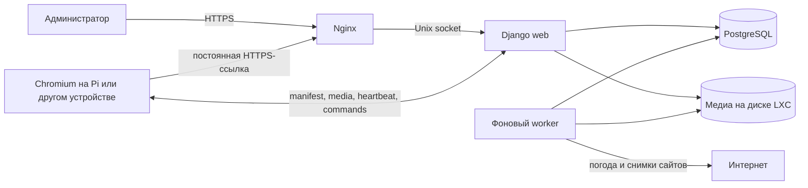

# Digital Signage ОГАУ ДО «СШ ВВЕ»: руководство и фактическая архитектура

Руководство для версии `0.5.0-browser`, обновлено 21 октября 2026 года.
Описывает браузерный показ, периодические подключения устройств и действующие
настройки серверной панели.

## 1. Краткий итог

- Сервер работает в одном Debian 13 LXC на Proxmox без Docker.
- Клиентом сейчас является обычный Chromium-совместимый браузер. Отдельного
  Pi-Agent в поставке нет.
- Raspberry Pi получает постоянную секретную HTTPS-ссылку и не требует установки
  программ из этого репозитория.
- При каждом новом открытии ссылки и перезагрузке страницы очередь начинается с
  первого активного элемента. После последнего элемента она повторяется. Каждый
  дисплей воспроизводит собственный цикл.
- По умолчанию полный плейлист не сохраняется: Chromium получает нужный ролик
  через HTTP Range и подкачивает его во время показа. Автономное сохранение всех
  медиа, включая видео, включается отдельно для конкретного экрана.
- Если Pi обычно выводит RTSP-камеру, существующая программа на Pi может открыть
  эту ссылку на несколько минут и закрыть браузер по своему расписанию. Новый
  Pi-Agent не требуется; сервер не управляет процессом браузера.
- HLS/DASH и несколько вариантов качества не используются, но неподходящие видео
  автоматически нормализуются в MP4/H.264/AAC; оригинал сохраняется отдельно.
- Звук без действия пользователя гарантирован только при запуске kiosk Chromium с
  разрешённым autoplay. В обычном браузере плеер при запрете запускает движение без
  звука; никаких кнопок и элементов управления на клиентском экране нет.
- HTTPS полностью поддерживает существующий Microsoft CA. Установщик проверяет
  предоставленные TLS-файлы и не заменяет их отдельным центром сертификации.
- SHA-256 используется в нескольких независимых местах: для целостности медиа,
  хранения секрета ссылки экрана и проверки SSH-узла. Это разные проверки.

## 2. Из чего состоит система



Серверные компоненты:

- **Nginx** завершает HTTPS, принимает большие загрузки и отдаёт защищённые
  медиафайлы с диска;
- **Django** предоставляет панель управления, формирует публикации, проверяет
  секретную ссылку экрана и обслуживает браузерный плеер;
- **PostgreSQL** хранит настройки, библиотеку, плейлисты, ревизии, экраны,
  команды, задания и журнал действий;
- **signage-worker** определяет тип файла, проверяет изображения, анализирует и при
  необходимости перекодирует видео, получает погоду и делает снимки сайтов;
- **файловое хранилище LXC** содержит оригиналы, совместимые варианты видео,
  снимки сайтов и резервные копии;
- **браузерный плеер** показывает собственную очередь от начала, получает видео
  через HTTP Range, а при включённом автономном режиме сохраняет полные медиа.

Между Nginx, Django и PostgreSQL нет отдельного TLS: все они находятся в одном
LXC и соединяются локально через Unix-сокеты. Локальный CA не используется для
внутренней аутентификации этих компонентов и не является центром выдачи
сертификатов экранам.

## 3. Основные понятия

| Понятие | Назначение |
| --- | --- |
| Контент | Сохранённое фото, видео или сайт. Один объект можно использовать многократно. |
| Виджет | Встроенный экран: часы, погода, заставка, фраза, объявление и т. п. Во внутренней модели прежнее техническое имя — `Scene`. |
| Плейлист | Упорядоченная очередь контента и виджетов с расписанием и параметрами показа. |
| Канал | Плейлист плюс тема, звук, часовой пояс, погода и набор фраз. |
| Публикация/ревизия | Неизменяемый снимок канала, который получают экраны. |
| Экран | Конкретное клиентское устройство с постоянной секретной ссылкой. |
| Ожидаемое расписание экрана | Когда ваша программа на Pi должна открыть браузер; позволяет отличать плановые паузы от потери связи. |
| Группа синхронизации | Старое организационное поле сохранено для совместимости. Версия 0.5.0 не привязывает позицию показа к общей временной шкале. |

Редактирование библиотеки или плейлиста само по себе не меняет работающие экраны.
Изменения начинают применяться только после команды **Опубликовать** у канала.

## 4. Полный путь файла от администратора до экрана

1. Администратор входит в панель `https://signage.vve.local/` и добавляет файл.
2. Браузер отправляет один файл обычной формой `multipart/form-data`.
3. Nginx передаёт запрос приложению без полного предварительного буферирования.
4. Django держит маленький файл в памяти, а файл больше 4 MiB записывает во
   временный файл на диске. После успешной загрузки оригинал оказывается в
   `/srv/signage/media/originals/<первые символы UUID>/<UUID>.<расширение>`.
5. В библиотеке появляется состояние **Обрабатывается**, а в PostgreSQL создаётся
   фоновое задание.
6. Тип не выбирается вручную: URL становится сайтом, а файл worker авторитетно
   распознаёт как фото или видео по содержимому.
7. Worker вычисляет SHA-256. Фото проверяется через Pillow, видео — через `ffprobe`.
   Если кодек/пиксельный формат не универсален для Chromium, FFmpeg создаёт вариант
   MP4/H.264 `yuv420p` с AAC и `faststart`, не удаляя оригинал.
8. При успехе сохраняются размер, MIME, разрешение, фактическая длительность и
   технические метаданные; состояние меняется на **Готов**. При ошибке — на **Ошибка**.
9. При добавлении в плейлист видео автоматически получает полную длительность,
   фото и сайт — 10 секунд. Новое расписание начинается в момент добавления,
   действует ежедневно весь день и не имеет конечной даты; всё можно изменить.
10. При публикации сервер создаёт новый неизменяемый manifest канала.
11. Экран проверяет новые данные примерно каждые 30 секунд. В обычном режиме
    получает медиа при показе. В автономном режиме сначала последовательно
    сохраняет файлы новой ревизии; последняя готовая программа продолжает работать
    до окончания подготовки.

### Ограничения загрузки на сервер

- Nginx разрешает тело запроса до **20 GiB**.
- Тайм-аут приёма тела — **1 час**.
- Это обычная, а не возобновляемая загрузка: при разрыве соединения файл придётся
  отправить заново.
- Интерфейс загружает по одному файлу за отправку; пакетная загрузка не сделана.
- Отдельного индикатора процента загрузки сейчас нет.
- SHA-256 требует один полный проход по файлу, а `ffprobe` имеет тайм-аут 120 секунд.
- Нужно оставлять свободное место как минимум ещё под размер крупнейшего файла;
  для эксплуатации разумен больший запас.

## 5. Как сейчас передаются и воспроизводятся файлы

### 5.1 Первая загрузка экрана

После открытия постоянной ссылки браузер регистрирует Service Worker, получает
manifest и начинает первый активный элемент. По умолчанию **Автономный показ**
выключен: полная очередь файлов в Cache Storage не загружается. Когда очередь
доходит до ролика, HTML5 `<video>` обращается к защищённому URL, а Nginx обслуживает
HTTP Range. Показ может начаться после получения необходимой части файла, а
остальное подкачивается по мере воспроизведения. Живые сайты открываются в `iframe`.

Обычный браузер может оставить часть уже полученных данных в своём HTTP-кеше.
Это решение браузера, а не обещание автономного хранения со стороны приложения.

Для работы без сети включите **Экраны → Настройки → Автономный показ**. Тогда
браузер по одному сохранит полные файлы опубликованного плейлиста, включая видео.
Это требует времени, трафика и диска в профиле браузера. Не отключайте сеть до
статуса **Готов к работе без сети** в разделе **Экраны**.

### 5.2 Следующая публикация

В обычном режиме новая опубликованная программа применяется после очередной
проверки. Видео не загружаются целиком заранее.

В автономном режиме файлы новой программы готовятся в отдельном кеше. До полного
завершения продолжает работать последняя готовая ревизия. При ошибке сети или
нехватке места она сохраняется, а новая подготовка повторится позже. Совпадающие
по SHA-256 медиа могут повторно использоваться из готового кеша.

При подготовке могут одновременно храниться старая и новая ревизии; необходимо
место с запасом. Готовой административной команды **Откатить публикацию** пока нет.

### 5.3 Похоже ли это на YouTube

Нет. В текущей версии отсутствуют:

- HLS или MPEG-DASH;
- разбиение видео на небольшие сегменты;
- несколько вариантов качества/битрейта;
- автоматическое переключение качества по скорости сети;
- продолжение оборванной загрузки.

Это обычное прогрессивное воспроизведение MP4: Nginx использует `sendfile` и HTTP
Range, а `<video>` запрашивает нужные диапазоны. По ощущениям ролик стартует до
полной загрузки, но это не адаптивный YouTube-подобный протокол.

### 5.4 Что будет при потере сети

| Режим | Поведение без связи с сервером |
| --- | --- |
| По сети, по умолчанию | Показ зависит от уже полученных данных браузера. Полный цикл без сети не гарантируется. |
| Автономный, готов | Оболочка, manifest, фото, видео и снимки сайтов работают из локального кеша. |
| Автономный, частично готов | Медиа сохранены, но живые сайты по-прежнему требуют сеть. |
| Автономный, загрузка/ошибка | Не отключайте сеть, рассчитывая на новую ревизию. Если есть старая полностью готовая, она сохраняется. |

Новые публикации, команды и погода без сети не поступают. Часы продолжают идти по
времени устройства; погода остаётся последней полученной. После перезагрузки
офлайн-запуск зависит от сохранности профиля, данных сайта и полной подготовки.
Браузер определяет доступную квоту и возможность постоянного хранения.

В таблице **Экраны** показаны состояние подготовки, число завершённых файлов,
объём, ревизия и ошибка. Если текущий кеш очищен, экрану потребуется подготовить
его заново. Не используйте приватный режим или автоматическую очистку профиля.

### 5.5 Что происходит между показами камеры

Ваша программа на Pi открывает постоянную ссылку в браузере, когда нужен плейлист,
и закрывает браузер, когда надо вернуть RTSP-камеру. Digital Signage не заменяет
эту программу. Каждое открытие начинает очередь заново; закрытие прерывает текущий
элемент, даже если видео не закончилось. Сайт не продолжает проигрывание при
закрытом браузере и не восстанавливает прежнюю позицию при следующем открытии.
При штатном закрытии окна браузер отправляет короткое уведомление, и панель
показывает «Окно закрыто» либо «Плановая пауза». Если уведомление не дошло,
например при отключении питания, отсутствие связи определяется примерно через
90 секунд. Открытое вне расписания окно отображается как фактически подключённое.

Для этого сценария достаточно режима **По сети**. Полный автономный кеш имеет смысл
только если во время открытого браузера действительно планируется потеря сети.

## 6. Видео: что поддерживается фактически

Worker проверяет файл по содержимому и анализирует потоки через `ffprobe`. Уже
совместимый MP4/H.264 `yuv420p` с AAC используется напрямую. Другие видеокодеки,
пиксельные форматы или звуковые кодеки автоматически преобразуются FFmpeg в
совместимый MP4/H.264/AAC с `faststart`; исходник остаётся в `originals`, вариант
для браузера создаётся в `renditions`.

Рекомендуемый исходник, который не потребует перекодирования:

| Параметр | Рекомендация |
| --- | --- |
| Контейнер | MP4 |
| Видео | H.264/AVC Main или High, `yuv420p` |
| Звук | AAC-LC |
| Подготовка файла | `faststart`, чтобы индекс MP4 находился в начале |
| Первая целевая нагрузка | Full HD, 25/30 кадр/с |

HEVC/H.265, MKV, MOV, AV1 и несовместимый звук принимаются как исходники, но до
публикации проходят перекодирование. Это может занять заметное время и потребовать
дополнительное место, особенно для 4K. Возможность вывести 4K на HDMI всё равно не
равна гарантии плавного показа конкретного 4K-файла; реальный материал нужно
проверить на Pi 5.

### Автозапуск и звук

Браузеры запрещают автоматическое воспроизведение со звуком без действия
пользователя. Плеер сначала пытается выполнить требуемую настройку. Если браузер
возвращает `NotAllowedError`, ролик немедленно повторно запускается без звука и без
каких-либо кнопок на клиентском экране. На постоянном kiosk-клиенте Chromium нужно запускать с
`--autoplay-policy=no-user-gesture-required`; веб-страница не может сама обойти эту
политику безопасности.

### Что проверено на установленном сервере

28 августа 2026 года выполнен реальный smoke-test через штатную HTTPS-панель:

- MP4, H.264 High, `yuv420p`, 1280×720, 25 кадр/с;
- AAC-LC, 48 kHz, mono;
- длительность 3 секунды, размер 1 049 515 байт, `faststart`;
- вход и отправка формы завершились HTTP 302 штатного успешного сценария;
- worker выполнил задание с первой попытки;
- результат: `ready`, `video/mp4`, 1280×720, 3000 ms;
- SHA-256 исходного и сохранённого файла совпал:
  `2060400cf3105dc66b3c95afa451228e812ff7b20a445bedcf390681c5b908ba`;
- повторный `ffprobe` подтвердил те же H.264/AAC и длительность;
- рабочий канал остался на ревизии 1;
- тестовый объект, файл и задание после проверки удалены.

Это подтверждает загрузку, сохранение, worker, `ffprobe` и SHA-256. Пока не выполнены
физические испытания большого файла, 4K-декодирования и длительного воспроизведения
на Raspberry Pi. Эти проверки должны быть частью приёмочного теста.

## 7. Фото и сайты

### Фото

Pillow проверяет, что файл действительно открывается как изображение, и определяет
его формат и разрешение. В плейлисте доступны режимы:

- **Заполнить без искажения** (`cover`) — края могут обрезаться;
- **Показать целиком** (`contain`) — возможны поля;
- **Растянуть** (`stretch`) — весь экран, но пропорции могут исказиться.

### Живой сайт

Сайт открывается непосредственно на клиенте в изолированном `iframe`. Для него
нужна сеть. Сторонний сайт может запретить встраивание через CSP или
`X-Frame-Options`, потребовать вход, cookies или интерактивное подтверждение. Кроме
того, HTTPS-страница плеера не должна встраивать небезопасный HTTP-контент.

### Снимок сайта

Серверный Chromium без пользовательской сессии открывает внешний публичный URL и
создаёт PNG 1920×1080. Ожидание отрисовки — до 10 секунд, общий тайм-аут — 45 секунд.
Полученный PNG ведёт себя как обычная картинка и работает офлайн.

Локальные и приватные IP-адреса сейчас блокируются как защита от SSRF для **обоих**
режимов — и живого сайта, и серверного снимка. Поэтому добавить внутренний intranet
URL без изменения политики приложения нельзя. Снимок не содержит авторизованную
сессию пользователя. Автоматическое периодическое обновление уже созданного снимка
и кнопка ручного обновления в текущем простом интерфейсе не реализованы.

## 8. Публикации, расписание и цикл

Элемент плейлиста может иметь:

- период **Показывать с / до**;
- дни недели;
- ежедневное окно времени, включая переход через полночь;
- включение/выключение;
- длительность для фото, сайта и виджета;
- способ масштабирования;
- громкость и отключение звука.

Для нового элемента автоматически подставляется практичный режим: начало — текущий
момент добавления, конечная дата отсутствует, дни недели не ограничены, ежедневное
окно не задано (то есть весь день). Фото и сайты получают 10 секунд, видео — полную
фактическую длительность. Эти значения не являются блокировкой и редактируются как
обычные поля.

Нижняя граница периода включительна, верхняя — исключительна: при наступлении
времени **до** элемент уже не показывается. Расписание вычисляется в браузере по
часовому поясу канала и времени, синхронизированному с сервером.

Когда сумма длительностей очереди закончилась, проигрывание начинается сначала.
Для видео в manifest записывается фактическая длительность файла. При открытии
страницы очередь начинается с первого разрешённого расписанием элемента, видео —
с начала. Перезагрузка страницы, в том числе кнопкой **↻** из панели, начинает
очередь заново. Позиция каждого дисплея независима; общее время публикации или
соседний экран не перематывают текущий ролик.

Изменение, отключение или удаление элемента не обрывает активную ревизию. Нужно
снова опубликовать канал, после чего клиенты безопасно подготовят следующую.

### Ожидаемое расписание подключений дисплея

Это отдельная настройка в **Экраны → Настройки**. Она описывает, когда ваша
программа на устройстве должна открывать браузер. Сервер не запускает и не
закрывает браузер самостоятельно. Расписание позволяет панели показывать
**Плановая пауза** вместо ошибочного сообщения о пропавшем экране между показами.

Доступны три режима:

- **Постоянно** — браузер ожидается открытым всё время;
- **Повторять через заданный интервал** — интервал запуска, длительность,
  рабочее время и дни недели;
- **В указанные промежутки времени** — до 32 непересекающихся окон,
  по строке `HH:MM-HH:MM` на каждое.

Пример: интервал **60 минут**, продолжительность **10 минут**, рабочее время
**09:00–18:00**. Браузер ожидается в 09:00–09:10, 10:00–10:10 и далее до
17:00–17:10. Между подключениями Pi показывает камеру. Настройте такой же график
в существующей программе Pi. Для запуска раз в два часа задайте 120 минут.

Пример точных окон:

```text
09:00-09:10
13:30-13:45
```

Без выбранных дней действует каждый день. Время относится к часовому поясу канала.
Это расписание доступности дисплея, а не разрешение показывать отдельную афишу:
ограничения материала по датам и времени настраиваются в его строке плейлиста.

## 9. Виджеты, объявления, фразы и погода

Раздел называется **Виджеты**. Можно создавать сколько
угодно независимых экземпляров каждого доступного типа, в том числе несколько
разных объявлений, а затем добавлять их отдельными строками в любой плейлист.

Реализованы виджеты:

- официальная заставка;
- часы и дата;
- погода;
- часы и погода;
- меняющаяся фраза;
- объявление.

При создании и редактировании доступны отдельные масштабы главного, основного и
дополнительного текста от 50% до 160%. Значения хранятся в настройках виджета и
применяются пропорционально на Full HD и 4K. Тип существующего виджета не меняется:
для другого типа создаётся новый объект.

Фразы хранятся набором, включаются и выключаются, переименовываются, сортируются и
могут иметь собственный период показа. Изменения фраз применяются после публикации
канала.

Worker получает Open-Meteo с заданным интервалом и сохраняет последний успешный
результат. При запросе программы сервер подставляет свежую погоду в опубликованные
виджеты, поэтому отдельная публикация канала для обновления температуры не нужна.
При проблемах API остаётся последнее успешное значение. Без связи с сервером
автономный экран показывает последнее сохранённое состояние.

## 10. Зачем нужен HTTPS

HTTPS нужен не ради доступа в Интернет и не ради отдельного Pi-Agent. Он решает три
задачи:

1. защищает логин и пароль администратора;
2. защищает постоянный секрет в ссылке экрана и команды управления от перехвата и
   подмены в локальной сети;
3. создаёт **secure context**, без которого браузер не разрешает штатную регистрацию
   Service Worker и, следовательно, надёжный офлайн-кеш.

Текущая схема использует только обычный серверный TLS. Клиентские сертификаты и
mTLS не настроены: Raspberry Pi предъявляет секрет из URL, а не свой сертификат.

## 11. Собственный CA и Microsoft CA

HTTPS использует выданный существующим Microsoft CA сертификат сайта.
Отдельный Signage CA не нужен ни серверу, ни браузерам. Других задач для собственного
центра сертификации у приложения нет.

В среде без своей PKI установщик умеет создать `VVE Signage Local CA`, но только
при явном `SIGNAGE_GENERATE_LOCAL_CA=true` и полном отсутствии всех TLS-файлов.
В корпоративной сети этот вариант не требуется.

Предпочтительный выпуск — создать закрытый ключ и CSR непосредственно в LXC, а в
Microsoft CA передать только CSR. Тогда закрытый ключ сайта никогда не покидает
сервер. Экспорт PFX из Windows тоже возможен, но требует защищённой передачи и
преобразования ключа в PEM для Nginx.

### Что нужно выпустить в Microsoft CA

Сертификат типа **Web Server** со следующими свойствами:

- Subject или удобное отображаемое имя: `signage.vve.local`;
- обязательный SAN: `DNS:signage.vve.local`;
- при реальном открытии по IP — дополнительный SAN `IP:192.168.110.222`, но
  рекомендуется всегда использовать DNS-имя;
- Extended Key Usage: Server Authentication;
- допустимый современный ключ RSA или ECDSA;
- доступные клиентам CRL/AIA-адреса корпоративного CA, если политика их проверяет.

Для Nginx нужны:

| Файл на сервере | Содержимое | Секретный |
| --- | --- | --- |
| `/etc/signage/tls/server.crt` | Сертификат `signage.vve.local` и промежуточные сертификаты в PEM | Нет |
| `/etc/signage/tls/server.key` | Соответствующий закрытый ключ конечного сертификата, PEM без интерактивного пароля | **Да** |
| `/etc/signage/tls/ca.crt` | Только публичная цепочка/корневой сертификат CA для проверки и, при желании, скачивания | Нет |

Нельзя передавать или размещать в LXC закрытый ключ корневого либо промежуточного
Microsoft CA. Нужен только закрытый ключ конкретного сертификата сайта.

Перед включением проверяются:

- читаемость PEM;
- совпадение публичного ключа сертификата и `server.key`;
- SAN и срок действия;
- полная цепочка;
- конфигурация Nginx;
- HTTPS health-check и открытие с клиента.

После успешной проверки Nginx перечитывает сертификат без изменения приложения,
БД, ссылок экранов или кеша. Старый локальный CA можно убрать из доверенных хранилищ
после того, как все клиенты перешли на новый сертификат. Endpoint
`/signage-ca.crt` не является обязательным для runtime: его можно направить на
публичный корневой сертификат организации. `install.sh` использует
`/etc/signage/tls/ca.crt` для проверки цепочки и HTTPS health-check. Если сертификат,
ключ или цепочка отсутствуют либо не прошли проверку, обновление останавливается:
существующие TLS-файлы не заменяются новым CA. Старый `/etc/signage/tls/ca.key`
после подтверждённого перехода не нужен.

### Доверие на Raspberry Pi

Если корпоративный корневой сертификат уже централизованно доверен устройству и
профилю Chromium, больше ничего не требуется. Для автономной настройки Linux нужно
установить **только публичный** корневой сертификат в системное хранилище и убедиться,
что его видит профиль Chromium. На новых версиях Chromium для Linux используется
NSS Shared DB; актуальный путь профиля следует проверять для установленной версии.

Доверие к собственному Microsoft CA полностью совместимо с изолированной локальной
сетью. Публичный центр сертификации и доступ клиента в Интернет не требуются.
Интернет нужен серверу только для выбранного API погоды и внешних сайтов.

## 12. Что именно означает SHA-256

В системе встречаются три независимых применения SHA-256.

### 12.1 SHA-256 медиафайла

Worker вычисляет хеш оригинала, а для перекодированного видео — отдельный хеш
варианта воспроизведения. В manifest записывается хеш именно тех байтов, которые
должен получить клиент. При полном автономном сохранении Service Worker передаёт
его механизму Subresource Integrity, включая загрузку видео. При обычном потоковом
показе видео защищено HTTPS, но браузер не пересчитывает его полный SHA-256 во время
Range-воспроизведения.

Это защищает от повреждения файла, неожиданной подмены содержимого, ошибки кеша или
несогласованности между manifest и хранилищем. HTTPS уже защищает канал и личность
сервера; SHA-256 дополнительно связывает публикацию с точными байтами конкретного
файла. Это не проверка узла перед соединением и не цифровая подпись: полностью
скомпрометированный сервер способен заменить и файл, и ожидаемый хеш.

### 12.2 SHA-256 секрета экрана

В БД хранится SHA-256 исходного случайного токена экрана. Ранее выданные ссылки
продолжают работать: сервер хеширует токен и сравнивает значения константным по
времени способом. В разделе **Экраны** и настройках экрана теперь постоянно доступны
кнопки **Копировать ссылку** и **Открыть экран**. Для повторно копируемой ссылки сервер
вычисляет отдельный HMAC-SHA256 из UUID экрана и хеша исходного токена с серверным
секретным ключом. Одних данных БД недостаточно для получения этой ссылки. Она не
меняется при редактировании имени или канала. При смене серверного SECRET_KEY
сохранённые ссылки нужно поддержать через SECRET_KEY_FALLBACKS; отзыв исходного
токена экрана отзывает оба варианта ссылок.

### 12.3 SHA-256 fingerprint SSH-ключа узла

Перед административным SSH-подключением проверяется короткий отпечаток публичного
host key контейнера и затем ключ закрепляется в `known_hosts`. Это защищает от
подключения не к тому серверу и от атаки посредника на SSH. Проверка относится к
SSH-развёртыванию и не связана ни с сертификатом сайта, ни с хешем видео.

TLS-сертификат браузер проверяет отдельно: строит цепочку до доверенного Microsoft
CA, проверяет подпись, SAN, срок действия и применимые политики.

## 13. Состояние Pi-Agent

Отдельный Pi-Agent **не реализован и сейчас не используется**:

- нет исполняемого агента или Python-пакета;
- нет клиентского установщика и systemd-unit для Pi;
- нет механизма обновления агента;
- нет watchdog, скриншотов экрана, перезагрузки ОС или управления Chromium как
  процессом;
- нет отдельного протокола регистрации/pairing агента.

Пустые локальные каталоги `client/pi_agent`, `client/tests` и `deploy/pi` не входят
в Git и не содержат реализации. В раннем описании агент был намерением, затем
плеер был переведён в browser-only архитектуру.

Серверные endpoint-ы manifest, media, heartbeat, commands и acknowledgement не
являются мёртвым наследием агента: ими прямо сейчас пользуется браузер. Они достаточно
нейтральны, чтобы в будущем тот же протокол мог использовать и агент. Существующая
программа пользователя для камеры/браузера не является частью Digital Signage и
может продолжать открывать постоянную ссылку по своему графику.

Незавершённые заготовки, не относящиеся к рабочему агенту: отдельный тип задания
`WorkerJob.TRANSCODE` пока не используется (нормализация выполняется внутри
проверки файла), каталог `thumbnails` не имеет рабочего конвейера, команды
доставляются heartbeat polling вместо SSE, watchdog renderer отсутствует.

## 14. Браузер или будущий Pi-Agent

| Возможность | Браузер сейчас | Возможный Pi-Agent |
| --- | --- | --- |
| Установка проекта на клиент | Не нужна | Нужна установка и обновление |
| Любое устройство с браузером | Да | Потребуется отдельная сборка под ОС |
| Фото, видео, виджеты, сайты | Да | Всё равно нужен браузер или несколько движков |
| Автозапуск и kiosk | Настраивается средствами ОС | Агент может настраивать/контролировать |
| Офлайн-кеш | Есть, но ограничен квотой браузера | Можно хранить обычные файлы без browser quota |
| Контроль процесса | Только команда reload страницы | Можно перезапускать зависший Chromium |
| Телеметрия | Heartbeat, ревизия, user-agent, ошибка | Можно добавить CPU, RAM, диск, температуру |
| Управление ОС | Нет | Можно добавить reboot, shutdown, обновление |
| Скриншот фактического экрана | Нет | Можно добавить |
| Цена по ресурсам | В основном Chromium | Малый daemon плюс всё тот же renderer |
| Headless ОС | Не выводит картинку без графического стека | Агент-демон может быть headless, но для HDMI всё равно нужен renderer |

Для текущих задач browser-only вариант закрывает основную функцию и сохраняет
независимость от Raspberry Pi. Лёгкий агент имел бы смысл прежде всего как
**необязательный supervisor**: запускать и перезапускать Chromium, собирать
телеметрию, управлять ОС и хранить большие файлы вне Cache Storage. Он не должен
заменять существующую ссылку или ломать обычный браузерный режим.

Пока реальные испытания не покажут зависания или нехватку контроля, добавление
агента увеличит объём сопровождения сильнее, чем улучшит собственно показ. Реальные
4K-файлы всё равно нужно проверить на Pi 5 после серверной нормализации.

## 15. Требования к клиентскому устройству

### Рекомендуемый вариант для Raspberry Pi 5

- Raspberry Pi OS 64-bit с графической средой или Debian 64-bit с минимальным
  Wayland/X-сеансом;
- Chromium актуальной версии;
- 4 GiB RAM как практический минимум проекта, 8 GiB — с запасом для 4K, тяжёлых
  сайтов и крупных кешей;
- достаточный SSD/microSD для ОС и профиля Chromium; при автономном режиме —
  дополнительно для полных медиа плейлиста и обновления кеша;
- корректный DNS для `signage.vve.local`;
- синхронизация времени;
- доверие к корпоративному Microsoft CA в профиле Chromium;
- отдельный пользователь и отдельный постоянный профиль браузера для каждого
  физического экрана.

Официальный kiosk-сценарий Raspberry Pi требует графический браузер и допускает
устройства от 1 GiB RAM, но это не означает, что 1 GiB достаточно для данного
плейлиста и больших видео. Точные CPU/RAM следует измерить на ваших файлах.

Полная desktop-среда не обязательна: можно поставить минимальный Wayland/X и
Chromium. Чистая console-only/headless система без графического стека не сможет
вывести браузерный плеер на HDMI. Будущий агент тоже потребует графический renderer,
если устройство должно показывать изображение.

## 16. Подключение нового экрана

1. Подготовить DNS и проверить открытие `signage.vve.local` с устройства.
2. Установить доверие к действующему корпоративному корневому CA.
3. Создать отдельного kiosk-пользователя и постоянный профиль Chromium.
4. В панели сервера открыть **Экраны**, нажать **Добавить экран**, выбрать канал и
   нажать **Копировать ссылку** в строке созданного экрана. Ссылку можно снова
   скопировать в любое время; она также доступна в настройках экрана.
5. Один раз открыть ссылку обычным окном и убедиться, что нет ошибки сертификата.
6. Указать ссылку в существующей программе переключения камеры и браузера.
   Для постоянно открытого экрана можно настроить автозапуск Chromium в kiosk-режиме:

```bash
chromium --kiosk --no-first-run --noerrdialogs \
  --disable-session-crashed-bubble \
  --autoplay-policy=no-user-gesture-required \
  'https://signage.vve.local/display/SCREEN_ID/SCREEN_TOKEN/'
```

7. В настройках экрана при необходимости задать ожидаемый график подключений,
   совпадающий с вашей программой Pi.
8. Открыть, закрыть и повторно открыть браузер. Проверить старт с первого элемента,
   полный цикл, звук и статус последней связи в панели.

Официальный Raspberry Pi OS с labwc запускает kiosk-команду из
`~/.config/labwc/autostart`. Конкретная инструкция зависит от выбранного образа ОС
и будет зафиксирована после приведения Pi к единой конфигурации.

Ссылка является секретом уровня bearer token. Её не следует публиковать, отправлять
в общедоступный чат или использовать на нескольких физических экранах. Если ссылка
утекла, текущий простой интерфейс не выпускает новый токен; безопасный вариант —
отключить старый экран и создать новый.

## 17. Работа в панели управления

### Контент

1. Открыть **Контент** → **Добавить контент**.
2. Ввести понятное внутреннее название.
3. Загрузить файл либо вставить URL — тип определится автоматически.
4. Для URL выбрать **Живой сайт** либо **Снимок сайта**.
5. Дождаться состояния **Готов**; несовместимое видео может обрабатываться дольше
   из-за автоматического перекодирования.

Контент можно искать, сортировать, переименовывать, включать и выключать. Удаление
разрешено только после удаления ссылок из плейлистов и сейчас является мягким:
запись скрывается, но автоматическое физическое освобождение исходного файла ещё не
реализовано.

### Виджеты и фразы

В **Виджетах** можно создать новый экземпляр часов, погоды, заставки, фразы или
объявления. Кнопка **Новое объявление** сразу открывает форму нужного типа. После
сохранения виджет нужно добавить в плейлист и опубликовать канал. В **Фразах** можно
добавлять, включать, отключать, менять порядок, длительность и даты действия.

### Плейлист

1. Создать плейлист или открыть стартовый.
2. Добавить контент либо виджет.
3. Проверить подставленные значения: видео — полная длительность, фото/сайт —
   10 секунд, начало сейчас, ежедневно весь день, без конечной даты.
4. При необходимости изменить длительность фото/сайта/виджета, расписание,
   масштабирование и звук.
5. Перетащить карточки в нужный порядок.
6. При необходимости временно отключить элемент без удаления из библиотеки.

### Канал и публикация

Канал связывает плейлист с темой, погодой, фразами и общим звуком. После любых
нужных изменений нажать **Опубликовать**. Публикация не должна выполняться, пока
нужный файл находится в состоянии **Обрабатывается** или **Ошибка**.

### Экраны и команды

Браузер отправляет heartbeat каждые 15 секунд. Manifest проверяется раз в 30 секунд.
Команды **предыдущий**, **следующий**, **перезагрузить**, **выключить/включить звук**
и **громкость** приходят с ближайшим heartbeat и подтверждаются браузером. Команда
живёт 5 минут.

Панель оценивает связь по давности heartbeat. Если ожидаемое расписание задаёт
паузу, показывается **Плановая пауза**, при необходимости — ближайший следующий
запуск. Если сейчас ожидается показ, но свежего heartbeat нет, проверяйте сеть,
питание и запуск браузера. Последняя связь помогает отличить старое сообщение от
текущего состояния.

Ссылка доступна для повторного копирования в строке каждого экрана и в его
настройках. Если автоматическое копирование запрещено браузером, адрес выделяется
для ручного Ctrl+C. Смена имени или канала не меняет ссылку, старые ранее выданные
адреса также продолжают работать.

Столбец **Автономный показ** отличает обычный режим **По сети** от подготовки
полной локальной копии. Готовность относится к конкретному браузеру: после очистки
профиля и до нового подключения панель не может знать, что кеш уже удалён.

### Роли и администрирование

- **Пользователь** загружает и редактирует контент, создаёт и заполняет плейлисты.
- **Модератор** дополнительно управляет виджетами, фразами, каналами, публикациями,
  экранами и командами, но не создаёт пользователей.
- **Администратор** имеет все возможности модератора и раздел
  **Администрирование** для учётных записей, ролей, активности и смены пароля.

Учётные записи безопаснее отключать, а не удалять. Интерфейс не позволяет
отключить себя или понизить последнего активного администратора.

### Обзор и встроенная вики

Для модератора и администратора обзор показывает CPU/load average, RAM, диск,
uptime LXC, состояния web, worker, Nginx, PostgreSQL и системных таймеров, а также
состояние обработки контента. Журнал сокращён до пяти последних понятных событий.

Кнопка **Вики** открывает встроенный справочный центр со статьями по контенту,
плейлистам, расписанию, виджетам, публикациям, экранам, ролям, kiosk Chromium,
HTTPS и диагностике. В статьях есть пошаговые сценарии, примеры и таблицы кнопок.

## 18. Минимальный приёмочный тест

Перед массовым развёртыванием выполнить на одном Pi 5:

1. загрузка фото Full HD и 4K;
2. загрузка рекомендованного MP4 Full HD;
3. отдельный тест каждого реального 4K-ролика;
4. первый запуск с пустым кешем и измерение времени/места;
5. публикация новой ревизии во время показа старой;
6. отключение сети во время фото и видео;
7. перезагрузка Pi при отключённом сервере;
8. восстановление сети и получение новой публикации;
9. звук, mute, volume, следующий/предыдущий;
10. расписание, включая границы дат и переход через полночь;
11. живой сайт и его ограничения iframe;
12. снимок внешнего сайта;
13. работа 24–72 часа без вмешательства;
14. заполнение кеша объёмом, близким к реальному;
15. холодная перезагрузка и автозапуск kiosk.
16. закрытие браузера с возвратом камеры и повторное открытие с первого элемента;
17. отображение плановой паузы и следующего запуска по ожидаемому графику;
18. автономный режим: дождаться готовности, пройти весь цикл без сети и проверить
    сохранение предыдущей программы при ошибке подготовки следующей.

## 19. Известные ограничения, важные до эксплуатации

1. Нет HLS/DASH, адаптивного битрейта и нескольких заранее подготовленных профилей
   качества; используется один совместимый прогрессивный MP4.
2. В режиме **По сети** автономный цикл не гарантируется. Для него нужно явно
   включить полное сохранение и дождаться готовности, включая все видео.
3. Нет возобновляемой и пакетной загрузки файлов.
4. Квота Cache Storage заранее не оценивается, результат `persist()` не показывается.
5. Автоматическое перекодирование имеет один общий профиль и может долго работать
   на больших 4K-исходниках.
6. Живые сайты офлайн не работают; сайты с авторизацией или запретом iframe могут
   не открыться в плеере.
7. Снимки сайтов не обновляются автоматически по расписанию.
8. Pi-Agent/watchdog и удалённое управление ОС отсутствуют. Открытие и закрытие
   браузера при переключении с RTSP выполняет существующая программа на устройстве.
9. Нет автоматической смены утёкшего токена экрана.
10. Производительность конкретных 4K-файлов и длительную работу нужно проверить
    на реальных Pi; серверные тесты не заменяют эту приёмку.
11. Переключение серверного указателя публикации атомарно, но каждый физический
    экран скачивает и активирует её независимо; одновременной транзакции на весь
    парк устройств нет.
12. Секретный token экрана является частью URL и может попадать в историю
    браузера, аргументы запуска kiosk и обычный access log Nginx. Ротации token и
    маскирования player URL в журнале пока нет.
13. Ожидаемое расписание дисплея не запускает и не закрывает процесс браузера.
    Его нужно согласовать с реальным графиком программы Pi.
14. Переключение релиза сервера не является транзакцией со схемой БД и общей
    статикой. Установщик делает dump перед миграциями; восстановление БД при
    несовместимом обновлении выполняется отдельно.
15. Удаление контента в панели мягкое: исходные файлы автоматически с диска не
    очищаются. Свободное место контролируется отдельно на **Обзоре**.

## 20. Сервер и резервирование

Текущие CPU, память, диск и состояния служб видны на **Обзоре**. Метрики учитывают
ограничения LXC. Планируйте размер медиадиска по объёму оригиналов, совместимых
видеокопий и резервных копий; перекодирование временно увеличивает расход места.

Ежедневный `pg_dump` хранится 14 дней, но он содержит только PostgreSQL. Нужен также
регулярный backup всего LXC или как минимум `/srv/signage`, иначе файлы библиотеки в
дамп БД не попадут.

Перед миграциями установщик делает отдельный `pre-deploy-<релиз>.dump`. Сертификат
Microsoft CA, ключ и цепочка проверяются до переключения релиза. Если проверка
запущенного приложения не прошла, возвращается предыдущая ссылка приложения;
миграции базы и общая статика автоматически назад не откатываются.

## 21. Рекомендуемое решение на текущем этапе

1. Оставить браузерный режим основным и обязательным.
2. Сохранить используемый Microsoft CA и централизованное доверие к нему.
3. В существующей программе Pi указать постоянную ссылку из **Экранов**.
4. Указать ожидаемый график в настройках экрана: например, 60/10 минут 09:00–18:00.
5. Оставить **Автономный показ** выключенным для периодических подключений к
   работающему серверу; включать только при необходимости работы без сети.
6. Настроить kiosk Chromium с разрешённым autoplay для гарантированного звука.
7. Провести приёмочный тест Full HD и реальных 4K-файлов, затем проверить
   несколько циклов «камера → браузер → камера» на одном Pi.

## 22. Официальные справочные материалы

- [Raspberry Pi: настройка kiosk-режима](https://www.raspberrypi.com/tutorials/how-to-use-a-raspberry-pi-in-kiosk-mode/)
- [Raspberry Pi: характеристики процессора и видеодекодирования Pi 5](https://www.raspberrypi.com/documentation/hardware/raspberrypi/bcm2835/)
- [Chromium: управление сертификатами в Linux](https://chromium.googlesource.com/chromium/src/+/master/docs/linux/cert_management.md)
- [MDN: Service Worker требует secure context](https://developer.mozilla.org/en-US/docs/Web/API/ServiceWorkerContainer/register)
- [MDN: квоты и удаление данных browser storage](https://developer.mozilla.org/en-US/docs/Web/API/Storage_API/Storage_quotas_and_eviction_criteria)
